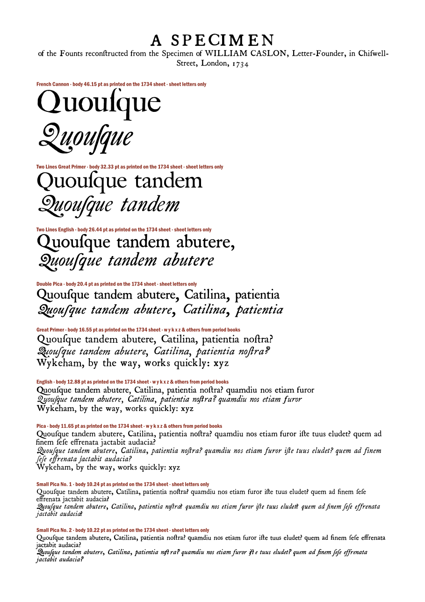

# Caslon 1734

Digital reconstructions of the types William Caslon showed on his first specimen
sheet (London, 1734), built from impressions of the real type rather than redrawn.
Every size on the sheet from French Cannon down to Brevier, roman and italic, plus
seven sizes of titling capitals: **62 fonts**.

## Two versions of every face

- **Clean** (`Caslon1734<Size>-Roman.otf`): the shape of the type itself, estimated by
  registering and averaging many impressions of each letter: the sheet's three copies,
  Caslon's later specimens of the same cuts (1764, 1766, 1785), and books printed in
  them (1730–1761).
- **Impression** (`Caslon1734<Size>Impression-Roman.otf`): one real, typical impression
  of each sort, as it printed, with its ink spread and texture.

## Faithful, not completed

Nothing is invented. A letter is used only when real impressions of that size and cut
exist; letters taken from books alone need at least five agreeing impressions in the
clean fonts, and a single impression checked by eye in the Impression fonts. Letters
for which no reliable impression exists are **missing**, and listed per font in
[DOCUMENTATION.md](DOCUMENTATION.md) section 8 and in the catalogue
([specimen/Caslon1734_catalogue.pdf](specimen/Caslon1734_catalogue.pdf)). Spacing that
could not be measured is estimated and says so.

How complete a face is depends on what survives. The text sizes (Double Pica to
Brevier) are near-complete alphabets. The three largest sizes (French Cannon, Two Lines
Great Primer, Two Lines English) appear on the sheet only as a line or two of
*Quousque tandem* and have about twenty characters each; the titling sizes have their
capitals (minus a few) from the sheet and Caslon's later specimens.

The fonts set long s (ſ) and the period ligatures (ſt, ſi, ſſ, ſh, ſk, ſl, ff, fi, fl,
ffi, ffl; ct as a historical ligature, feature `hlig`) where the face has them. Type
ſ directly, or turn on the `hist` feature (off by default), which makes initial and
medial s long except before b, f and k and at the end of a word.

## Sizes

| 1734 name | Measured body | Fonts |
|---|---|---|
| French Cannon | 46.2 pt | roman, italic |
| Two Lines Great Primer | 32.3 pt | roman, italic |
| Two Lines English | 26.4 pt | roman, italic |
| Double Pica | 20.4 pt | roman, italic |
| Great Primer | 16.5 pt | roman (with small capitals), italic |
| English | 12.9 pt | roman (with small capitals), italic |
| Pica | 11.7 pt | roman (with small capitals), italic |
| Small Pica No. 1, No. 2 | 10.2 pt | roman, italic |
| Long Primer No. 1, No. 2 | 9.2 pt | roman, italic (No. 1 roman with small capitals) |
| Brevier | 7.7 pt | roman, italic |
| Titling 1–7 | 75.3, 61.0, 44.2, 34.8, 30.7, 24.0, 21.2 pt | capitals (a few lowercase in 1–2) |

Bodies are the line pitch of the sheet's solid-set blocks, measured on the 600 ppi
scan, in points of 1/72 inch. Each font's em is its own measured body, so setting every
font at the size in this table reproduces the sheet at actual size.

## Repository

- `fonts/`: the 62 OpenType (CFF) fonts.
- `specimen/`: the catalogue (every font, every character, what each lacks) and a
  specimen sheet.
- `DOCUMENTATION.md`: aims, every source, the pipeline, rules and decisions, quality
  checks and fidelity, every fix, and what each face contains.
- `EXTENDING.md`: how to add a source, a letter or a size and rebuild.
- `scripts/`, `configs/`, `transcriptions/`: the complete pipeline (Python).
- `sources_manifest.json` + `scripts/fetch_sources.py`: the scans are not
  redistributed; this downloads exactly the ~1,500 pages used, from their holders.
- `WORKLOG.md`: the dated working log.

## Credits

The reconstruction depends entirely on scans made freely available by:

- **McGill University Library**, Rare Books and Special Collections: the 1734
  specimen sheet (via the Internet Archive).
- **The Internet Archive** and its contributing libraries (University of
  California, University of Toronto, Getty Research Institute, Boston Public Library
  and others): Caslon's 1764, 1766 and 1785 specimens and the books.
- **Wellcome Collection**: the Long Primer No. 2 and Double Pica books.

Historical guidance from James Mosley, *Recasting Caslon Old Face* and his writing
on the Caslon foundry. See DOCUMENTATION.md for every item used.

## Licence

Fonts: [SIL Open Font License 1.1](OFL.txt), Reserved Font Name "Caslon 1734".
Code and documentation: [MIT](LICENSE).
